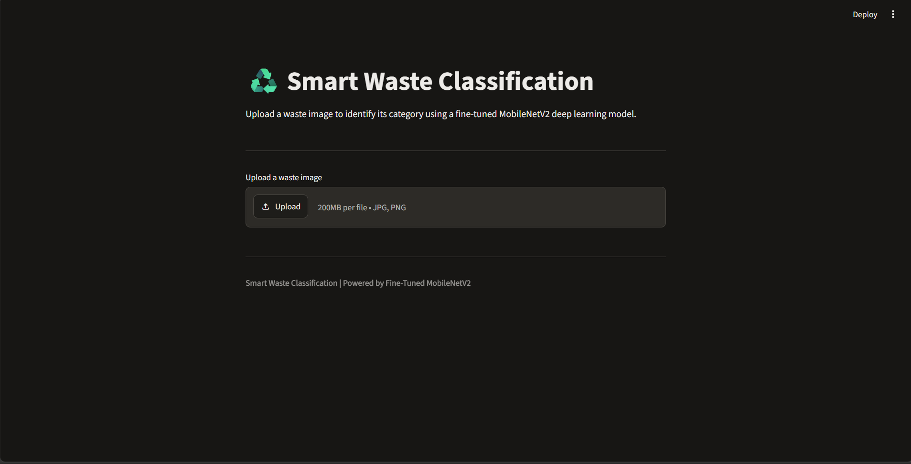
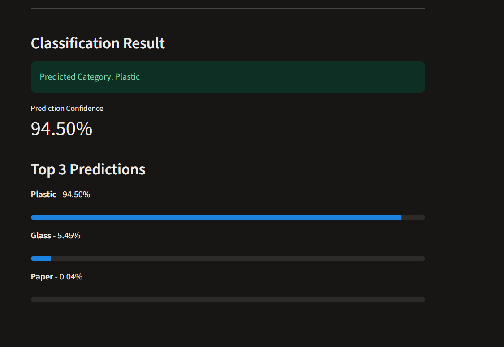
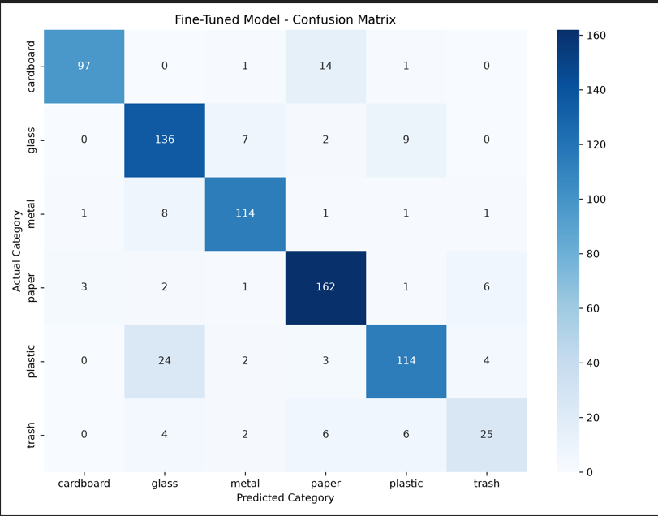

# Smart Waste Classification and Recycling Assistant

## 1. About the Project

Smart Waste Classification and Recycling Assistant is a machine learning-based web application that identifies different types of waste using image classification.

The system uses a deep learning model based on MobileNetV2 to classify uploaded waste images into six categories. It also provides recycling information to help users understand how to dispose of waste properly.

## 2. Objectives

- Identify waste categories using images.
- Apply deep learning for image classification.
- Improve waste segregation.
- Provide recycling information.
- Build a simple and user-friendly web application.

## 3. Technologies Used

- Python
- TensorFlow
- Keras
- MobileNetV2
- NumPy
- Pandas
- Matplotlib
- Seaborn
- Scikit-learn
- Streamlit

## 4. Dataset Details

The project uses a dataset containing 2,527 images divided into six categories.

| Waste Category | Number of Images |
|---|---:|
| Trash | 137 |
| Plastic | 482 |
| Paper | 594 |
| Metal | 410 |
| Glass | 501 |
| Cardboard | 403 |
| **Total** | **2,527** |

## 5. Dataset Preparation

The dataset is divided into:

- Training data: 70%
- Validation data: 30%

Image preprocessing includes:

- Resizing images to 224 × 224 pixels.
- Applying MobileNetV2 preprocessing.
- Applying data augmentation.
- Preparing category labels.

## 6. Model Development

The project uses MobileNetV2, a pre-trained convolutional neural network.

The following steps are performed:

1. Load the pre-trained MobileNetV2 model.
2. Add classification layers.
3. Train the model using the waste dataset.
4. Fine-tune selected layers.
5. Evaluate the model using validation data.
6. Save the trained model.

## 7. Model Performance

The fine-tuned model achieved **85.49% validation accuracy** on 758 validation images.

### Category-wise Performance

| Category | Precision | Recall | F1-Score |
|---|---:|---:|---:|
| Cardboard | 96% | 86% | 91% |
| Glass | 78% | 88% | 83% |
| Metal | 90% | 90% | 90% |
| Paper | 86% | 93% | 89% |
| Plastic | 86% | 78% | 82% |
| Trash | 69% | 58% | 63% |

## 8. Application Features

- Upload waste images.
- Predict waste categories.
- Display prediction confidence.
- Show top three predictions.
- Provide recycling information.
- Display a warning for low-confidence predictions.

## 9. Application Screenshots

### Application Homepage



### Waste Classification Prediction



### Model Confusion Matrix



## 10. Project Structure

```text
Smart-Waste-Classification/
│
├── dataset/
│   ├── cardboard/
│   ├── glass/
│   ├── metal/
│   ├── paper/
│   ├── plastic/
│   └── trash/
│
├── model/
│   ├── best_waste_model.keras
│   ├── best_waste_model_finetuned.keras
│   ├── best_waste_model_improved.keras
│   ├── class_names.txt
│   ├── confusion_matrix.png
│   └── confusion_matrix_finetuned.png
│
├── screenshots/
│   ├── 01-homepage.png
│   ├── 02-prediction.png
│   └── 03-confusion-matrix.png
│
├── app.py
├── explore_dataset.py
├── view_dataset.py
├── prepare_dataset.py
├── train_model.py
├── train_model_finetune.py
├── train_model_improved.py
├── evaluate_model.py
├── requirements.txt
└── README.md
```

## 11. Installation and Execution

### Step 1: Clone the Repository

```bash
git clone YOUR_GITHUB_REPOSITORY_URL
```

### Step 2: Open the Project Folder

```bash
cd Smart-Waste-Classification
```

### Step 3: Create a Virtual Environment

```bash
python -m venv venv
```

### Step 4: Activate the Environment

For Windows PowerShell:

```powershell
venv\Scripts\Activate.ps1
```

### Step 5: Install Dependencies

```bash
pip install -r requirements.txt
```

### Step 6: Run the Application

```bash
streamlit run app.py
```

The application will open in your web browser.

## 12. Future Enhancements

- Improve classification accuracy.
- Add more waste categories.
- Improve plastic and trash recognition.
- Develop a mobile application.
- Integrate real-time camera-based detection.
- Provide more detailed recycling recommendations.

## 13. Conclusion

The Smart Waste Classification and Recycling Assistant demonstrates how deep learning can be used to identify different types of waste through image classification.

Using MobileNetV2 and TensorFlow, the project classifies six waste categories and provides recycling information through a Streamlit web application.

This project demonstrates the practical application of machine learning and web development in supporting better waste segregation and recycling awareness.

## Author

**Sangam Dilip Reddy**

**Project:** Smart Waste Classification and Recycling Assistant
